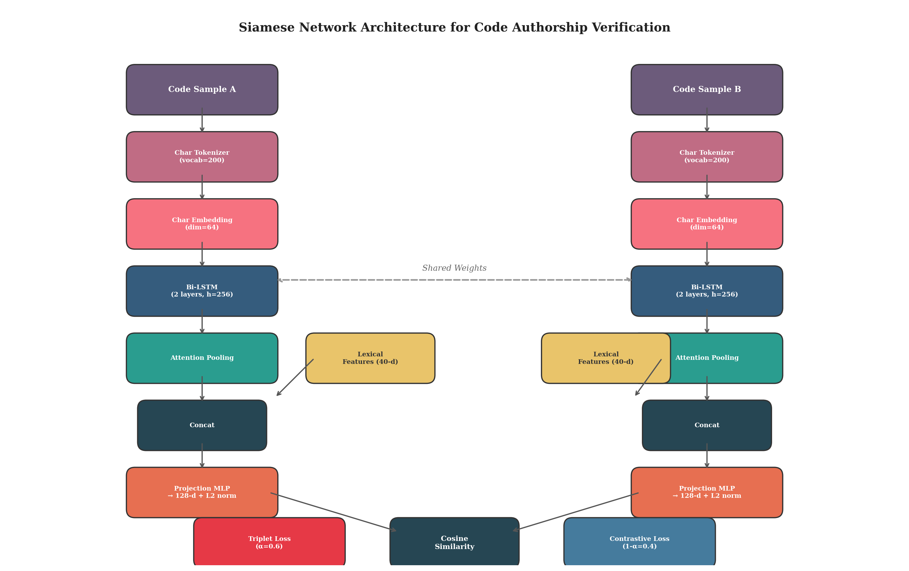
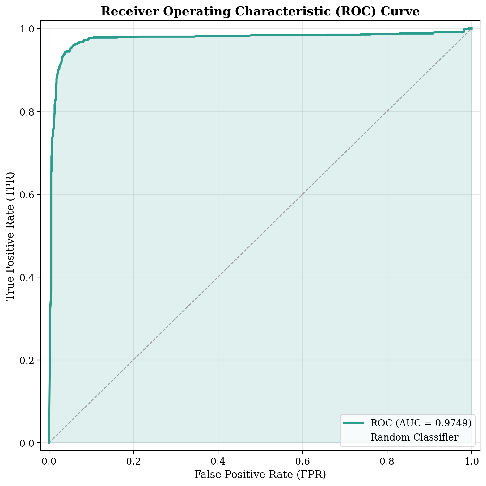
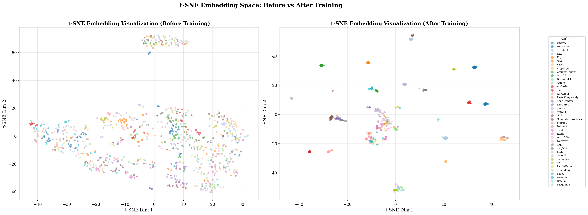

# Code Authorship Attribution & Verification

Multimodal deep learning pipelines for C/C++ source code authorship analysis, covering closed-set author identification, human-vs-AI code detection, and open-set author verification via metric learning.

## Overview

This repository implements three complementary modeling directions on C/C++ submissions (such as Google Code Jam solutions and human/AI code benchmarks):

1. **Closed-Set Code Attribution (`code_attribution/`)**: Identifies the author among top-N programmers (or classifies Human vs. AI code) using character-level BiLSTM + lexical features, Tree-sitter AST Graph Attention Networks (GAT), and four multimodal fusion strategies (feature concatenation, bidirectional cross-attention, decision-level ensembling, and multi-seed weight averaging / model soups).
2. **Open-Set Author Verification (`code_verification/`)**: Learns 128-dimensional L2-normalized author embeddings on author-disjoint splits so that verification generalizes to unseen developers via pairwise similarity and N-vs-1 enrollment signatures.
3. **Dataset Processing & Diagnostics (`data_processing/`)**: Cleans and deduplicates C/C++ CSVs, extracts C++ samples from Parquet benchmarks, provides a rule-based human/AI style heuristic, and generates t-SNE embedding visualizations.



## Implemented Architectures

### Sequential & Lexical Branch (`code_attribution/sequential.py`)
- **Character Encoder**: `CharVocabulary` (top 200 characters, `MAX_SEQ_LEN = 2000`) -> 64-d embedding -> 2-layer bidirectional LSTM (`hidden_dim = 256`, 512-d output) -> `AttentionPooling`.
- **Lexical Features (`LexicalFeatureExtractor`, 41-d)**: 3 identifier casing ratios (`camelCase`, `snake_case`, `ALL_CAPS`), 25 C++ keyword frequencies, `for`/`while` ratio, 3 indentation statistics, 2 comment rates (`//`, `/*`), 3 line-length statistics, 2 punctuation densities (`{`, `;`), blank-line rate, and short-identifier rate (`len <= 2`). Note: `architecture_diagram.png` labels the lexical branch as 40-d, while `LexicalFeatureExtractor.feature_dim` computes 41 features (`3 + 25 + 1 + 3 + 2 + 3 + 2 + 1 + 1`).
- **Modes**: Closed-set `TOP_N_AUTHORS = 20` attribution (`AI_MODE = False`) or binary Human vs. AI classification on `datasets/ai_hum.csv` (`AI_MODE = True`, default in `Config`).

### AST Graph Attention Network (`code_attribution/ast_gnn.py`)
- **Graph Construction (`ASTGraphBuilder`)**: Parses C++ source code with `tree-sitter-cpp` (BFS truncation at `MAX_AST_NODES = 2000`, `MAX_NODE_TYPES = 200`), adding bidirectional parent-child edges, adjacent-sibling edges, and normalized BFS depth.
- **Graph Classifier (`ASTGATClassifier`)**: 64-d node-type embedding summed with a linear depth projection, followed by 3 `GATConv` layers (4 heads of dim 128 in layers 1-2, 1 head of dim 128 in layer 3) with `BatchNorm1d`, ELU, and dropout (`0.3`), concatenated `global_mean_pool` + `global_max_pool` (256-d), and a 2-layer MLP head.

### Multimodal Fusion & Ensembling (`code_attribution/fusion/`)
- **Feature Fusion (`fusion.py`)**: `FeatureFusionClassifier` concatenates the 512-d BiLSTM pooling vector, 256-d AST-GAT graph vector (masked via `graph_valid` when AST parsing fails), and 41-d lexical vector into a 3-layer MLP (`256 -> 128 -> num_classes`).
- **Cross-Attention Fusion (`cross_attention_fusion.py`)**: `CrossAttentionFusionModel` projects pre-pooling BiLSTM token states (512-d) and dense AST node embeddings (128-d) to `d_model = 256`, applies bidirectional 8-head `nn.MultiheadAttention` (`seq_to_ast_attn` and `ast_to_seq_attn`) with residual `LayerNorm`, pools via `AttentionPooling` (sequence) and masked mean pooling (AST), and classifies from the 512-d fused representation using AMP mixed precision on CUDA.
- **Late / Decision-Level Ensemble (`ensemble_fusion.py`)**: Combines pretrained `bilstm_style_classifier.pt` and `ast_gat_classifier.pt` predictions via simple averaging, validation grid-searched weighted averaging, majority voting with confidence tie-breaking, and a 2-layer `StackingMLP` meta-learner.
- **Weight Averaging (`weight_average_fusion.py`)**: Trains 3 seeds (`[42, 123, 7]`) of BiLSTM and AST-GAT and evaluates uniform parameter averaging, exponential moving average (`decay = 0.8`), and validation greedy model soup.

### Open-Set Metric Learning (`code_verification/`)
- **Hybrid Triplet + Contrastive Siamese (`siamese/triplet_contrastive.py`)**: `CodeEmbeddingNet` (2-layer BiLSTM + `AttentionPooling` + 41-d lexical features + MLP projector to L2-normalized 128-d embeddings), optionally initialized from `bilstm_style_classifier.pt`. Trained with `ClassBalancedBatchSampler` (8 authors x 8 snippets/author) on author-disjoint splits (`TOP_N_AUTHORS = 50`, `MIN_SAMPLES_PER_AUTHOR = 10`, 70% train / 15% val / 15% test) using:
  $$\mathcal{L} = 0.6 \cdot \mathcal{L}_{\text{triplet}}^{\text{semi-hard}} + 0.4 \cdot \mathcal{L}_{\text{contrastive}}^{\text{hard}}$$
  with cosine distance $1 - \cos(u, v)$ and margin $1.0$, a 3-epoch projector warmup, cosine learning-rate decay with 5-epoch linear warmup, and early stopping (`patience = 10`). Evaluates both pairwise verification and N-vs-1 cluster enrollment (`n_enroll = 5`) on unseen test authors.
- **Pairwise & Multi-Sample Siamese (`multisiamese/siamese.py`, `multisiamese/multisiam.py`)**:
  - `siamese.py`: Pairwise `SiameseCodeEncoder` trained with Euclidean `ContrastiveLoss` (`margin = 1.0`) on `TOP_N_AUTHORS = 50` (`MIN_SAMPLES_PER_AUTHOR = 15`, 80/10/10 author-disjoint split).
  - `multisiam.py`: `MultiSiamEncoder` and `MultiSiamLoss` (L2-normalized embeddings, `GROUP_SIZE = 4` snippets per author, triplet margin `0.5`) for N-vs-1 author signature verification.

## Verified Verification Results

The plots in `plots/` record the held-out evaluation of the hybrid triplet-contrastive Siamese verification model (`code_verification/siamese/triplet_contrastive.py`) on unseen test authors across 2,690 balanced test pairs (1,345 same-author, 1,345 different-author):

| Metric | Value | Source Plot |
|---|---|---|
| Test ROC-AUC | `0.9749` | [`plots/roc_curve_test.png`](plots/roc_curve_test.png) |
| Test EER (cosine threshold `0.414`) | `0.0506` (`5.06%`) | [`plots/det_curve_test.png`](plots/det_curve_test.png) |
| Confusion Matrix (`thr = 0.414`) | `TP=1277`, `TN=1277`, `FP=68`, `FN=68` (`94.94%` acc/F1) | [`plots/confusion_matrix_test.png`](plots/confusion_matrix_test.png) |
| Mean Per-Author Verification (`1 - EER`, 35 authors) | `0.952` (range `0.92` to `0.97`) | [`plots/per_author_performance.png`](plots/per_author_performance.png) |

Over 10 epochs of Phase 2 training (`plots/training_curves.png`), validation EER drops from `~0.183` (epoch 1) to `~0.094` (epoch 10) while validation AUC-ROC rises from `0.900` to `~0.966`.

| Verification ROC & DET | Embedding Separation (t-SNE) |
|---|---|
|  |  |

## Repository Structure

```text
code_attribution/
  sequential.py                     BiLSTM + 41-d lexical style classifier (author or AI/Human)
  ast_gnn.py                        Tree-sitter C++ AST graph builder and 3-layer GAT classifier
  fusion/
    fusion.py                       Concatenation feature fusion (BiLSTM + AST-GAT + lexical)
    cross_attention_fusion.py       Bidirectional multi-head cross-attention fusion
    ensemble_fusion.py              Decision-level averaging, weighted average, voting, stacking MLP
    weight_average_fusion.py        Multi-seed uniform, EMA, and greedy soup parameter averaging
code_verification/
  siamese/
    triplet_contrastive.py          Hybrid semi-hard triplet + hard contrastive Siamese verifier
  multisiamese/
    siamese.py                      Pairwise Euclidean contrastive Siamese encoder
    multisiam.py                    N-vs-1 group-signature MultiSiam encoder and evaluator
data_processing/
  data_clean.py                     C/C++ file filter and (username, task) deduplicator
  process_parquet_to_csv.py         Parquet-to-CSV C++ extractor for ai_hum.csv
  detector_utils.py                 CodeStyler rule-based Human vs. AI heuristic classifier
  visualize_embeddings.py           Batched t-SNE visualization for MultiSiam checkpoints
plots/                              Saved training curves, ROC/DET, confusion matrix, PCA/t-SNE plots
pyproject.toml                      Python >= 3.12 package metadata and dependencies
uv.lock                             Locked dependency graph
```

## Setup and Usage

### Installation

Requires Python >= 3.12 (`.python-version` pins `3.12.12`).

```bash
# With uv
uv sync

# Or with pip
python3 -m venv .venv
source .venv/bin/activate
pip install -e .
```

### Dataset Preparation

Scripts expect CSV files under `datasets/` with columns `flines` (source code), `username` (author label), and optionally `task` / `file`:

```bash
# Filter C/C++ files and deduplicate by (username, task)
python data_processing/data_clean.py -i raw_csvs/ -o datasets/cleaned.csv

# Extract C++ rows from a Parquet benchmark into datasets/ai_hum.csv
python data_processing/process_parquet_to_csv.py benchmark.parquet \
  --cleaned datasets/cleaned.csv \
  --out datasets/ai_hum.csv
```

### Closed-Set Attribution

```bash
# Sequential BiLSTM + lexical features (set Config.AI_MODE = False for 20-author attribution)
python code_attribution/sequential.py

# Tree-sitter AST + GAT classifier
python code_attribution/ast_gnn.py

# Multimodal feature concatenation fusion
python code_attribution/fusion/fusion.py

# Bidirectional cross-attention fusion
python code_attribution/fusion/cross_attention_fusion.py

# Decision-level ensembling (requires bilstm_style_classifier.pt and ast_gat_classifier.pt)
python code_attribution/fusion/ensemble_fusion.py

# Multi-seed parameter averaging and greedy soup
python code_attribution/fusion/weight_average_fusion.py
```

### Open-Set Verification

```bash
# Hybrid triplet + contrastive Siamese verification (saves model/siamese_verification.pt)
python code_verification/siamese/triplet_contrastive.py --epochs 50 --batch-size 64

# Pairwise contrastive Siamese baseline
python code_verification/multisiamese/siamese.py

# N-vs-1 MultiSiam verification
python code_verification/multisiamese/multisiam.py
```

### Verification Inference API

```python
from code_verification.siamese.triplet_contrastive import load_verifier, verify

model, vocab, lex_ext, threshold = load_verifier(
    "model/siamese_verification.pt",
    device="cpu",
)

same_author, similarity = verify(model, vocab, lex_ext, threshold, code_a, code_b)
print(f"Same author: {same_author} (cosine similarity={similarity:.4f}, threshold={threshold:.4f})")
```
